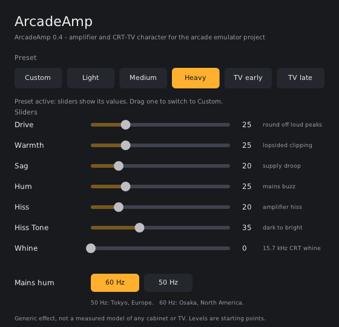

# Arcade Cabinet Acoustic Emulator for MAME

A researched Equalizer APO project for approximating the acoustic character of arcade cabinets and CRT televisions when running MAME or other retro software on modern audio hardware.

The project keeps the original **Arcade Boost** preset intact while adding hardware-oriented profiles, CRT-TV profiles, Equalizer APO signal-processing features, optional nonlinear VST processing, and a documented measurement/IR path.

## What this project models

A real cabinet is a chain, not just an EQ curve:

**game/audio hardware → DAC/mixer → amplifier → speaker → enclosure/mounting → listener**

Equalizer APO can reproduce much of the **linear** part of that chain: gain, filtering, channel routing, frequency shaping, delay, resonance-style filters, and convolution when a genuine impulse response is available. It cannot by itself reproduce nonlinear amplifier behavior such as harmonic saturation or clipping.

That is why the project has two layers:

1. **Core profiles** — Equalizer APO only. These are the reproducible, evidence-labelled profiles.
2. **Optional VST layer** — a separate experimental stage for nonlinear coloration. It is never silently baked into the core presets.

## Quick start

**New to this?** Read the illustrated [`docs/SETUP-GUIDE.md`](docs/SETUP-GUIDE.md). It covers everything below in more detail.

1. Install Equalizer APO and select the Windows playback device used by MAME in the Configurator.
2. Copy this repository's `presets/` directory into the Equalizer APO `config` directory.
3. Copy the repository `config.txt` into that configuration directory, after backing up your existing configuration.
4. Open the Equalizer APO Configuration Editor.
5. Enable **one** `Include:` line for the profile you want.
6. Save and test with MAME.

Equalizer APO's configuration system supports `Include:` files, `Copy:` channel routing, `GraphicEQ:`, `Modal` filters, and `Convolution:`. The official configuration reference documents these commands and their processing behaviour.

## Profile families

### Arcade

`presets/arcade/` contains hardware-family profiles. The profile comments distinguish documented routing/hardware facts from experimental acoustic modelling.

Important examples:

- `neogeo-mvs.txt` — general MVS model.
- `neogeo-mvs-mono.txt` — explicit mono/single-speaker variant.
- `cps1.txt` — representative mono-oriented CPS1 routing.
- `cps2.txt` — CPS2/QSound-oriented stereo model.
- `midway-dcs.txt` — Midway DCS family; routing depends on DCS generation/title.
- `konami-k053260.txt` — K053260-era systems; routing is title/board dependent.
- `segamodel2-deluxe.txt` — specifically a deluxe/subwoofer-oriented Model 2 model.
- `igs-pgm2-dodonpachi-daioujou-tamashii.txt` — PGM2/YMZ774-oriented profile.

### CRT television

`presets/crt-tv/` is deliberately separated from arcade cabinets. These profiles represent the built-in speaker/amplifier chain of home CRT televisions by broad era rather than pretending that one EQ curve represents every television model.

Where documentation gives real hardware information, it is used as a hardware anchor. Nominal speaker impedance/power is **not** converted into a fabricated frequency response.

## Evidence levels

The project uses these labels consistently:

- **MEASURED** — a direct acoustic/electrical measurement exists.
- **DOCUMENTED** — supported by service documentation, manuals, schematics, or technical source material.
- **EMPIRICAL** — based on observed/listening/field evidence but without a calibrated transfer measurement.
- **INFERRED** — derived from documented architecture; not directly measured.
- **EXPERIMENTAL** — a listening-oriented model where the exact response is not established by measurement.

A documented amplifier model does not automatically prove a frequency response. A speaker's impedance or power rating does not prove its acoustic transfer function.

## Optional nonlinear VST processing: ArcadeAmp

The `vst-plugin/` directory contains **ArcadeAmp**, a small open-source plugin (GPL-2.0-or-later) written for this project. It adds what a linear equalizer cannot: **saturation, asymmetry (even harmonics), power-supply sag, mains hum, hiss and the 15.7 kHz CRT whine**. It has a small window with six presets (Light, Medium, Heavy, TV early, TV late, Custom), so most users click one button.

* **Status:** v0.4. Works in Equalizer APO 1.4.2 on Windows as reported by the project owner (one listener, 2026-11-09). Unit-tested; the shipped DLL and its window were also exercised under Wine (`docs/testing/TEST-REPORT.md`).
* **What it is not:** a measured model of any specific amplifier or TV. Only the whine frequency (NTSC / NTSC-J line rate) and the 50/60 Hz mains frequencies are documented numbers; every level is a usability choice, labelled EXPERIMENTAL.
* **Setup with pictures:** [`docs/SETUP-GUIDE.md`](docs/SETUP-GUIDE.md). Reference: `docs/VST-SETUP.md`. Per-profile presets: `presets/experimental-vst/README.md`.
* **Why it exists and how it got here:** `docs/research/VST.md` (research), `docs/history/ARCADEAMP-DEVELOPMENT-LOG.md` (four versions, each driven by a real field report, with measurements).

The VST layer is optional. The core profiles never depend on it. Noise is treated cautiously: it can add audible texture but cannot be called an authentic MVS/CRT noise floor without a measurement.

## Convolution / impulse responses

`impulse-responses/` documents the measurement path for future real cabinet captures.

A genuine cabinet/system IR is substantially more informative than inventing a dense EQ curve, but an IR should only be added when its capture chain, sample rate, channel layout, and provenance are known. The project does not ship a fabricated arcade-cabinet IR.

## Research, history and tests

Nothing is thrown away; each layer documents the one before it.

| Where | What |
|---|---|
| `docs/research/` | Per-topic research: hardware, Equalizer APO, CRT TVs, Neo Geo MVS, VST, measurement and IR method, source register, evidence matrix |
| `docs/history/PROJECT-HISTORY.md` | How the project evolved, phase by phase, and why |
| `docs/history/ARCADEAMP-DEVELOPMENT-LOG.md` | ArcadeAmp v0.1 to v0.4: every field report, cause, fix and measurement |
| `docs/testing/TEST-REPORT.md` | What was tested and how, results, field reports, what is not verified |
| `vst-plugin/tests/` | The test programs and their recorded outputs |
| `CHANGELOG.md` | Release notes |

## Original project

The original files are kept **exactly as authored**, in the repository root:

- `arcade-boost.txt` and `arcade-boost.peace`: the original preset (Preamp -2.5 dB; low shelf 95 Hz +11 dB; peak 315 Hz -4 dB; high shelf 7 kHz +2 dB).
- `arcade-boost-apo.txt`: the same values written in the Equalizer APO syntax from its Configuration reference, used by `config.txt`. (The original `.txt` uses `Filter 1: LS f=95 Hz gain=11 dB Q=0.71`, which differs from that syntax; it was not tested here.)
- `flat-mame.mp3` and `arcade-boosted.mp3`: the original comparison recordings. Listen to the difference: [flat](flat-mame.mp3) and [boosted](arcade-boosted.mp3).
- The original README is preserved as [`docs/history/ORIGINAL-README-v1.md`](docs/history/ORIGINAL-README-v1.md).

The original preset is the project's historical baseline and is not represented as a measured universal arcade response.

## Project status

The strongest parts of the project are now the hardware/routing documentation and the separation between documented facts and experimental acoustic modelling.

The major missing dataset remains the same: **calibrated measurements of original arcade cabinet electro-acoustic chains**. The project is structured so those measurements can replace experimental curves later without redesigning the repository.

Beginner guide: `docs/SETUP-GUIDE.md`. Reference: `docs/USER-GUIDE.md`. Optional plugin: `docs/VST-SETUP.md` and `presets/experimental-vst/`. Research trail: `docs/research/SOURCES.md`.
