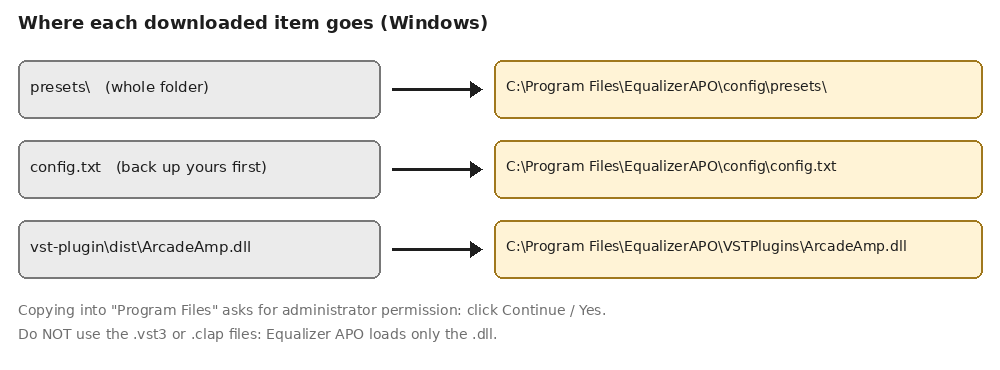
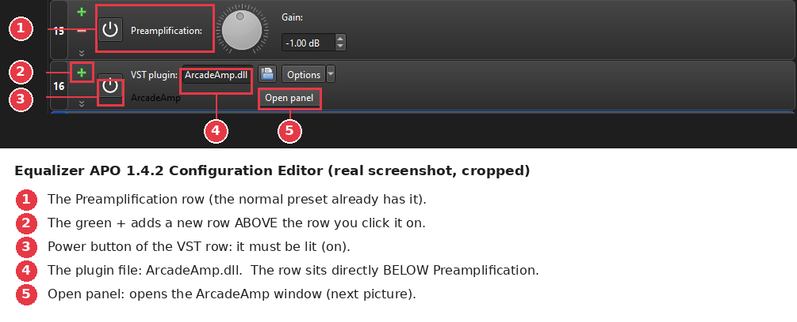
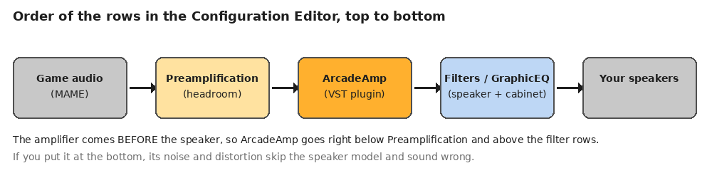
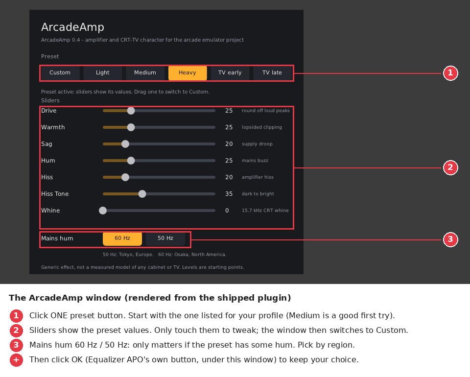

# Setup guide for beginners (with pictures)

This guide is for people who have never touched an audio configuration file.
You need: Windows 10 or 11, MAME (or any emulator), about 15 minutes.

There are **two parts**. Do Part A first. Part B is optional and adds the
ArcadeAmp plugin on top.

* **Part A: the profile** (the cabinet or TV sound). Works on its own.
* **Part B: ArcadeAmp** (amplifier saturation, hum, hiss, CRT whine).
  Optional and experimental.

> **About the pictures.** Pictures 2 and 3 are real: picture 2 is a cropped
> screenshot of Equalizer APO 1.4.2 taken by the project owner, picture 3 is
> the real ArcadeAmp window. Pictures 1 and 4 are drawings I made to explain
> folders and order. Steps that have no picture say so. If you take
> screenshots of the missing steps, see `docs/images/README.md`.

---

## Part A: install a profile

### A1. Install Equalizer APO

1. Download **Equalizer APO** from its official page:
   <https://sourceforge.net/projects/equalizerapo/> (the 64-bit installer,
   version 1.4.2 is the one this project was tested with).
2. Run the installer. At the end the **Configurator** opens.
3. In the Configurator, tick the **playback device you listen to MAME
   with** (for example your speakers or headphones), then confirm.
   Equalizer APO only affects devices you tick here.
4. Restart the computer if the installer asks you to.

*(No picture for this step. Button names may differ slightly between
versions.)*

### A2. Download this project

1. On the GitHub page of this project click **Code**, then **Download ZIP**.
2. Unzip it somewhere easy, for example your Desktop.

### A3. Copy the files to the right place (picture 1)



1. **Back up your own settings first.** Open
   `C:\Program Files\EqualizerAPO\config\` and copy `config.txt` to
   `config-backup.txt` (right-click, Copy, then Paste).
2. Copy the project's **`presets`** folder into
   `C:\Program Files\EqualizerAPO\config\`.
3. Copy the project's **`config.txt`** into the same folder and accept
   replacing the old one (you made a backup).
4. Windows asks for administrator permission to write into *Program
   Files*: click **Continue** or **Yes**.

### A4. Choose ONE profile

1. Open `C:\Program Files\EqualizerAPO\config\config.txt` with **Notepad**
   (right-click, *Open with*, *Notepad*).
2. You will see a list of lines that start with `#Include:`. The `#` means
   "switched off".
3. Pick **one** profile for the machine you want to hear and delete the `#`
   at the start of **that one line only**. Example for the Neo Geo MVS:

   ```text
   Include: presets/arcade/neogeo-mvs.txt
   ```

   Every other `#Include:` line stays switched off.
4. Save the file (Ctrl+S).
5. Start MAME and play a game. You should hear the sound change straight
   away (usually less bass and a more "small cabinet" tone). If you want to
   hear the difference, comment the line out again (put the `#` back) and
   save.

Which profile for which machine is listed in `docs/PROFILE-CATALOG.md`. The
television profiles are in `presets/crt-tv/`: 1970s, 1980s, 1990s, 2000s.

**Arcade and TV profiles are alternatives: switch on only one at a time.**

If nothing changes, go to *Troubleshooting* at the end.

---

## Part B (optional): add ArcadeAmp

ArcadeAmp adds things an equalizer cannot: it rounds off loud peaks, sags a
little under load, and adds hum, hiss and (for TVs) the high-pitched
"whine" of a CRT. It is **generic**: it is not a measured copy of any
particular amplifier. Treat it as flavour. The sound of Part A still works
without it.

### B1. Copy the plugin (picture 1 again)

Copy `vst-plugin\dist\ArcadeAmp.dll` from the downloaded project into
`C:\Program Files\EqualizerAPO\VSTPlugins\` (Equalizer APO's installer
creates this folder; it is the place its audio service can always read).
Only the **`.dll`** is used. Ignore the `.vst3` and `.clap` files.

### B2. Make your own copy of the profile

This keeps the original safe.

1. In `C:\Program Files\EqualizerAPO\config\presets\arcade\` copy
   `neogeo-mvs.txt` (or your profile) and paste it, then rename the copy to
   `neogeo-mvs-arcadeamp.txt`.
2. In `config.txt` change your active line to use the copy:

   ```text
   Include: presets/arcade/neogeo-mvs-arcadeamp.txt
   ```

### B3. Open the copy in the Configuration Editor and add the plugin row (picture 2)

1. Start **Configuration Editor** from the Windows Start menu.
2. Choose **File, Open** and pick `neogeo-mvs-arcadeamp.txt`. Each line of
   the file is a row.
3. Find the **Preamplification** row (picture 2, marker 1). Click the green
   **+** on the row **directly below it**. The **+** adds the new row
   **above** the row where you click it (marker 2), so the new row lands
   directly under Preamplification.
4. In the menu that opens, open **Plugins** and choose **VST plugin**.
5. In the new row, click the small blue **folder / disk icon** next to the
   file name box and pick `ArcadeAmp.dll` from the `VSTPlugins` folder
   (marker 4).
6. Make sure the round **power button** of that row is lit (marker 3).

**Check the order:** the VST row must sit **directly below Preamplification**
and **above the filter rows** (picture 4). If it landed somewhere else,
drag the row by its number to the right place.





### B4. Choose a preset in the ArcadeAmp window (picture 3)

1. On the VST row click **Open panel** (marker 5 in picture 2). The
   ArcadeAmp window opens.
2. Click **one preset button**. The right one for each machine is in
   `presets/experimental-vst/README.md`. If unsure, click **Medium**.
3. Pick **60 Hz** or **50 Hz** for the "Mains hum" switch if your preset has
   hum (everything except Light does). 50 Hz is eastern Japan and Europe,
   60 Hz is western Japan and North America. It is a small detail; if you do
   not care, leave it.
4. Click **OK** under the window (this button belongs to Equalizer APO).
   **Cancel** throws your change away.
5. Save the file (File, Save, or Ctrl+S).



*(The OK/Apply/Cancel buttons and the "Apply automatically" tick box are
Equalizer APO's own, shown under the window. They are not in my picture
because they are not part of the plugin.)*

### B5. Listen

Play MAME. What to expect:

* The volume should **not get louder**. It can be up to about 1 to 2 dB
  **quieter** on the heavier presets. If you want it back, raise the
  Preamplification row by that amount.
* **Hum and hiss** are easiest to hear in silent moments (title screen,
  between songs). On small speakers you mostly hear the buzzy upper part of
  the hum, not the deep part.
* **Whine** (TV presets only) is at 15.7 kHz. Many adults and most laptop
  speakers will not reproduce it. Headphones help.
* To confirm the plugin really is working: open the window, choose
  **Custom**, drag **Drive** to 100, listen, then bring it back down.

To switch it off: click the power button of the VST row (it goes dark).

---

## Which preset for which profile?

Short version (full table and the reasoning in
`presets/experimental-vst/README.md`):

| Profile | ArcadeAmp preset |
|---|---|
| Neo Geo MVS mono cabinet | Heavy |
| Most other arcade profiles | Medium |
| CPS3, Sega Model 2 deluxe | Light |
| 1970s and 1980s TV | TV early |
| 1990s TV | TV late |
| 2000s TV | Light |

These are starting points chosen by hardware class, **not measurements**.

---

## Troubleshooting

| What you see | What to do |
|---|---|
| No change in sound at all | Is the playback device ticked in the **Configurator**? Is one `Include:` line active (no `#`)? Did you restart? Does the Configuration Editor show an error? |
| Sound is too loud or crackles | Lower the **Preamplification** row by 2 to 3 dB. Some profiles boost some frequencies. |
| Sound is too quiet | See `docs/research/EQAPO.md` on headroom; raise Preamplification in small steps and stop if it crackles. |
| "VST plugin" is missing from the **+** menu | It is under **Plugins**, inside the + menu. |
| The plugin file box is red or empty | Use the folder icon and pick `ArcadeAmp.dll` from `C:\Program Files\EqualizerAPO\VSTPlugins\`. Equalizer APO warns if its audio service cannot read a file elsewhere. |
| Equalizer APO closes when you click **Open panel** | You have an older ArcadeAmp (v0.3 or older). Use the `ArcadeAmp.dll` from this project (v0.4), delete the old VST row and add the plugin again. Background: `docs/history/ARCADEAMP-DEVELOPMENT-LOG.md`. |
| Clicking sliders changes nothing in the text line | A preset other than **Custom** overrides the sliders. Drag a slider in the window and it switches to Custom by itself. |
| I hear nothing from the hum or whine | Hum shows up in quiet moments; whine is very high-pitched. Test with Custom, Hum 40. |
| It sounds worse | Switch the VST row off (power button). The profile never depends on the plugin. |

Still stuck? Open an issue and attach the Windows crash entry if there was
one (Event Viewer, Windows Logs, Application).
