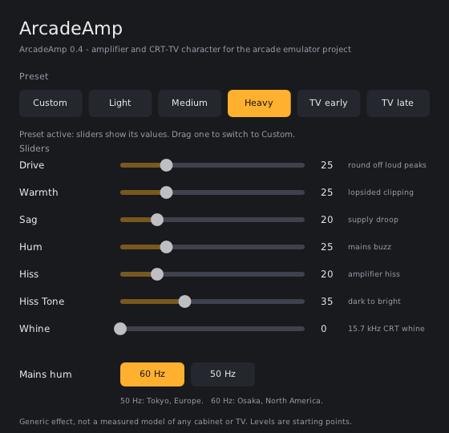

# ArcadeAmp v0.4 - an open-source amplifier and CRT-TV character stage

Nine controls in a small plugin window, but most people only click one **Preset** button.



The picture is the real window rendered from the shipped Windows DLL (under Wine). While a preset is active the sliders show its values; dragging one switches to Custom.

| Control | What it does | Default |
|---|---|---|
| **Preset** | Custom / Light / Medium / Heavy / TV early / TV late. Anything but Custom overrides every other control except Mains 50Hz. | Custom |
| **Drive** | Rounds off loud peaks like an amplifier running out of headroom | 10 % |
| **Warmth** | Lopsided rounding: adds even harmonics (single-ended stage character). Needs Drive > 0 | 0 |
| **Sag** | Power-supply droop: loud passages lose a little gain, then recover | 0 |
| **Hum** | Mains buzz (harmonics of 50/60 Hz, 2nd dominant) | 0 |
| **Hiss** | Broadband hiss | 0 |
| **Hiss Tone** | Dark/rumbly (0) to bright/airy (100), same loudness | 50 |
| **Whine** | 15,734 Hz CRT line-rate whine | 0 |
| **Mains 50Hz** | Off = 60 Hz hum, On = 50 Hz hum | Off |

Settings per profile: `../presets/experimental-vst/README.md`. Setup steps:
`../docs/VST-SETUP.md`.

## Why this exists

Equalizer APO's own filters (`GraphicEQ`, `Modal`, `Delay`, `Copy`; see
`../docs/research/EQAPO.md`) are all **linear**. They reshape frequency
content and timing. They cannot saturate, cannot change gain with signal
level, and cannot add a noise floor, and real amplifiers and TVs do all
three. ArcadeAmp adds those missing nonlinear and level-dependent pieces.

Two ready-made plugins were tried first and did not work out (Airwindows
PurestDrive: no reliably sourced VST2 build; PeakEater: ships CLAP/LV2/VST3
only, and stock Equalizer APO hosts none of those). Details are in
`../docs/research/VST.md`. So this plugin was written to fit the project.

## Version history

| Version | What happened |
|---|---|
| v0.1 | First release. Tested by the project owner: the volume jumped, drive was hard to tell from clipping, and the mains buzz and colour options produced no audible result. |
| v0.2 | Root causes found by re-creating v0.1 and measuring it at MAME-realistic levels (table below) and fixed, but the controls were cut to three (Drive, Noise, Mains). |
| v0.3 | Features restored and extended, on the fixed base: Warmth, Sag, separate Hum / Hiss / Hiss Tone, CRT Whine, plus a Preset selector so everyday users need one control. **Clicking Open panel in Equalizer APO crashed it** (no plugin window; see below). |
| v0.4 | Adds the plugin window Equalizer APO's panel requires: preset buttons, sliders, 60/50 Hz switch. The sound is unchanged. |

### The v0.1 bugs (all fixed, all covered by tests)

Measured with peaks around 0.3 (typical MAME level), not full scale:

| Problem reported | Cause | v0.1 | now |
|---|---|---|---|
| Volume jumps up | "Gain compensation" normalised for a full-scale peak, so quiet audio was boosted | +2.2 dB at Drive 0 %, +5.5 dB at 12 %, +8.1 dB at 25 % | Drive 5 / 12 / 25 %: -0.05 / -0.27 / -1.09 dB; never louder |
| Hard to tell drive from clipping | The boost pushed signals into clipping downstream | n/a | Output can never exceed input level, so the stage cannot add clipping |
| No audible buzz | The right channel's hum was frozen (the oscillator only advanced during the left channel's pass) | Right channel: no hum at all | Left and right are bit-identical |
| No audible buzz / noise | Hiss sat near -65 dBFS; the hum was a pure sine at 60/120 Hz, which the MVS profile's own 85 Hz high-pass cuts by 7-10 dB | Left -49.7 dBFS, right -65 dBFS at "10 %" | Harmonic-rich buzz; Hum 25 % = -46.5 dBFS, about -47.4 dBFS after the MVS filters |

## The DSP

All of it is in `source/ArcadeAmpDSP.hpp`, about 320 lines (roughly half of it comments), with comments.
Signal path, per sample:

```text
in > Sag (supply droop) > Drive / Warmth (saturation) > DC block > + Hum + Hiss + Whine > out
```

One amplifier and one power supply, so the sag detector and every noise
source are shared by both channels.

### Drive: `out = tanh(k*x) / k`, k = Drive x 0.1

* Small-signal gain is exactly 0 dB at every setting: quiet passages are not
  made louder. `|out| <= |in|`: it only rounds off peaks. Drive 0 is a
  bit-exact bypass.
* Because it only acts on loud peaks, **Drive does nothing audible on quiet
  material, and higher settings make loud peaks quieter, not louder.** On a
  0.3-peak tone, Drive 25 lowers the RMS by about 1.1 dB.
* `tanh` is the textbook soft clipper (J. O. Smith, *Physical Audio Signal
  Processing*). Generic. **Not** a measurement of any arcade or TV amplifier.

### Warmth: asymmetric clipping

Positive and negative half-waves get different k: `kPos = k(1+w)`,
`kNeg = k(1-w)`, `w = Warmth x 0.008`. Symmetric clipping makes odd
harmonics only; an asymmetric stage also makes even ones (INFERRED from
amplifier theory). Small-signal gain stays 0 dB and each half is still no
louder than the input. The DC offset this creates is removed by a 5 Hz
high-pass (real amplifiers are AC-coupled). Measured on a 0.5-peak 500 Hz
tone at Drive 40: Warmth 0 gives no 2nd harmonic at all; Warmth 50 gives it
at -16.8 dB, Warmth 100 at -11.8 dB relative to the fundamental.

### Sag: level-dependent gain

`g = 1 / (1 + s x env)`, `s = Sag x 0.02`, where `env` is a peak follower
(attack 8 ms, release 120 ms) of the loudest channel. An unregulated supply's
rail droops under load and recovers over tens to hundreds of ms (INFERRED);
the depth and time constants are **EXPERIMENTAL**. `g <= 1` always. Measured at
Sag 50: a 0.05-peak tone loses 0.4 dB, a 0.6-peak tone loses 3.8 dB; after
a loud burst the gain recovers to its own steady state. A linear EQ cannot do
this.

### Hum: mains buzz

Built from the harmonic series of the mains frequency with the 2nd harmonic
dominant: a linear supply with a full-wave rectifier leaves ripple at twice
the mains frequency (100/120 Hz), a weaker component at the mains frequency
itself stands in for transformer stray-field pickup, and higher harmonics
decay. **The individual harmonic weights are an approximation chosen to sound
like a rectifier buzz, not measured from any cabinet.** The 50/60 Hz choice is
real: Japan has a split grid (eastern Japan 50 Hz, western Japan 60 Hz).

### Hiss and Hiss Tone

White noise through a one-pole low-pass whose corner runs from 1 kHz (Tone 0)
to 16 kHz (Tone 100), re-normalised so loudness stays the same at every
tone. The colour is EXPERIMENTAL.

### Whine

A pure tone at 15,734.26 Hz, the NTSC / NTSC-J horizontal scan rate
(4.5 MHz / 286). The frequency is a documented standard, used by Japanese TVs
and standard-resolution 15 kHz arcade monitors. Real sets emit the whine
acoustically from the flyback transformer and it can leak into the audio;
**how loud it was in any given set is not known here** (EXPERIMENTAL). PAL
(15,625 Hz) is not modelled. At sample rates under 35 kHz it stays silent
rather than alias.

### Level mapping

Hum and Hiss: `dBFS RMS = -54 + 0.30 x %` (100 % = -24, 25 % = -46.5).
Whine: `-60 + 0.30 x %`. These are usability choices so that 20 to 30 % is
plainly audible in quiet moments. **They are not a measured noise floor**
(none exists in this project; see `../docs/research/MVS.md`). All noise is off
by default.

### Presets

Resolved in `ArcadeAmpDSP::presetParams()` (values in
`../docs/VST-SETUP.md`). They are EXPERIMENTAL starting points chosen by
hardware class. Measured effect of the processing on a 0.3-peak tone, noise
excluded: Light -0.05 dB, Medium -0.70 dB, Heavy -1.81 dB, TV early -1.81 dB,
TV late -0.70 dB. Never louder.

### What it does not do

* It does not model any specific documented amplifier, speaker, cabinet or TV
  from this project's research.
* It is not a substitute for the deferred convolution phase
  (`../docs/research/MEASUREMENTS-AND-IR.md`). Convolution captures the linear
  cabinet response; this plugin adds nonlinearity, level dependence and noise.

## Installing

See `../docs/VST-SETUP.md`. In short: copy `dist/ArcadeAmp.dll` somewhere
permanent, add a VST plugin row in Equalizer APO's Configuration Editor,
click *Open panel*, choose a Preset.

| File in `dist/` | For |
|---|---|
| `ArcadeAmp.dll` | **Stock Equalizer APO** (VST2): use this one |
| `ArcadeAmp.vst3/` | The community VST3 build of Equalizer APO, or any VST3 host |
| `ArcadeAmp.clap` | CLAP hosts (not usable with Equalizer APO) |

Because the control layout changed, **remove any old ArcadeAmp row from your
Equalizer APO config and add the plugin again.**

## How this was verified, and what wasn't

1. `tests/dsp_test.cpp` includes the *same* `ArcadeAmpDSP.hpp` that is
   compiled into the plugin and checks, at MAME-realistic levels through the
   real two-channel `process()` path in awkward block sizes: exact bypass;
   level neutrality for Drive/Warmth/Sag combinations (and a -60 dBFS
   small-signal gain of 0 dB); hostile +-4.0 input never louder and finite;
   Warmth makes even harmonics and no DC; Sag is level dependent and
   recovers; Hum and Hiss levels match the mapping, left == right; Hiss Tone
   keeps loudness and changes colour; Whine frequency and level at 44.1, 48
   and 96 kHz and silence at 32 kHz; hum harmonics for 60 and 50 Hz;
   presets; runtime parameter slams and a live 60 to 50 Hz switch;
   in-place processing. Recorded result: `tests/dsp_test-output.txt`.
2. `tests/host_test.cpp` is a minimal VST2 host that loads the **actual
   plugin wrapper** (built for Linux from the same source), reads the nine
   parameters the way a host does, selects presets through the VST2
   parameter API and processes audio. Recorded result:
   `tests/host_test-output.txt`. It confirms the wrapper, the Preset
   selector and the level behaviour end to end.
3. `tests/winhost_test.cpp` loads the shipped **Windows `ArcadeAmp.dll`** under Wine, runs the same kind of queries a host's parameter panel makes (names, labels, display strings, parameter properties, automation flags, string-to-parameter), sweeps every parameter, processes audio and closes the plugin. Recorded result: `tests/winhost_test-output.txt`. `host_test` additionally fails if any parameter reports integer limits a host would read as min >= max (see the crash note below).
4. The Windows binaries were cross-compiled with mingw-w64; their format,
   exports (`VSTPluginMain`, `main`), imports (system DLLs only) and
   parameter names were checked.


### The "Open panel" crash (v0.3), and what fixed it

Reported with a Windows crash log: faulting module `Editor.exe` (Equalizer APO's own editor), exception `c0000005` (access violation). Equalizer APO's open-source code shows why: **Open panel always asks the plugin for an editor window** (`effEditGetRect`, `effEditOpen`, `effEditGetRect`) and reads the returned rectangle without checking that the plugin has an editor. ArcadeAmp v0.3 had no window, the rectangle pointer was never set, and the Editor crashed on it. v0.4 has a real window, so the pointer is set.

A second, smaller defect was found on the way and fixed: the Preset parameter was flagged as an integer parameter, and the plugin framework reports integer limits in a layout hosts read as `min = 0, max = 0`. The flag is gone and `tests/host_test.cpp` now fails if a parameter reports limits a host would misread.

What is verified for the window: `tests/winui_test.cpp` loads the shipped Windows DLL under Wine and does what the Editor does (get rectangle, open the editor into a parent window, get rectangle again, run the idle loop), then clicks the Heavy button, drags a slider and clicks the 50 Hz button with real mouse messages, and checks the plugin's parameter values and that closing works (`tests/winui_test-output.txt`). The screenshots in `docs/` come from that run. 
**Field confirmation (2026-11-09):** the project owner reports that v0.4 works in Equalizer APO 1.4.2 on Windows: the Open panel window opens, the window is fine, and the sound changes. One listener, a report, not a measurement. Full history: `../docs/history/ARCADEAMP-DEVELOPMENT-LOG.md`; test records: `../docs/testing/TEST-REPORT.md`.

## Not verified

* Any match to a real cabinet or TV (the plugin is generic).
* Listening by more than one person.
* The `.vst3` and `.clap` builds in a host (format-checked only).

## License

GPL-2.0-or-later (`LICENSE.txt`), as required by DPF's default VST2 build
path. DPF itself is ISC-licensed.
